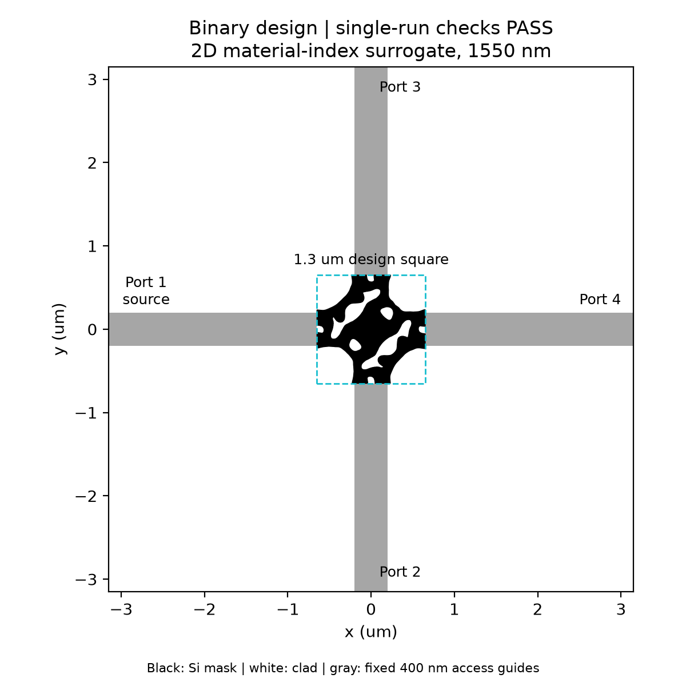
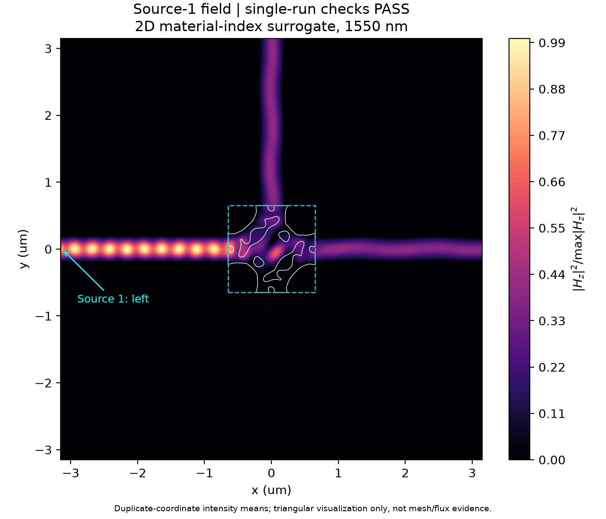
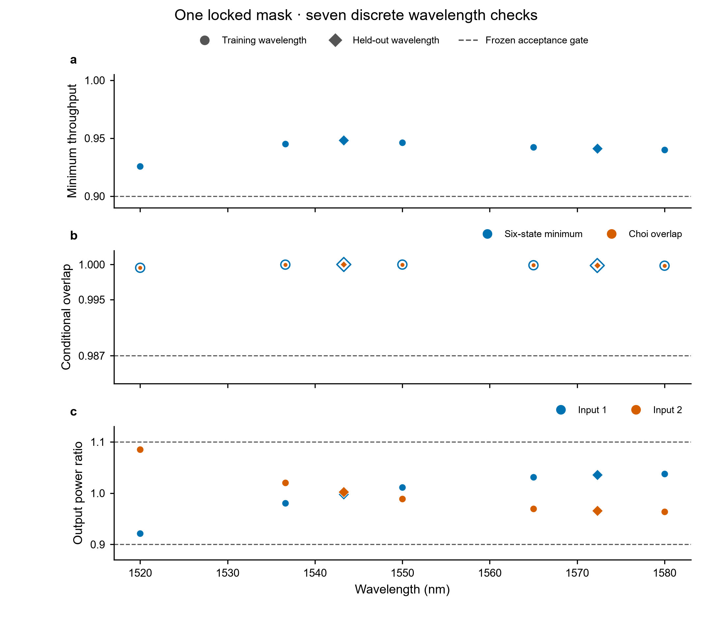
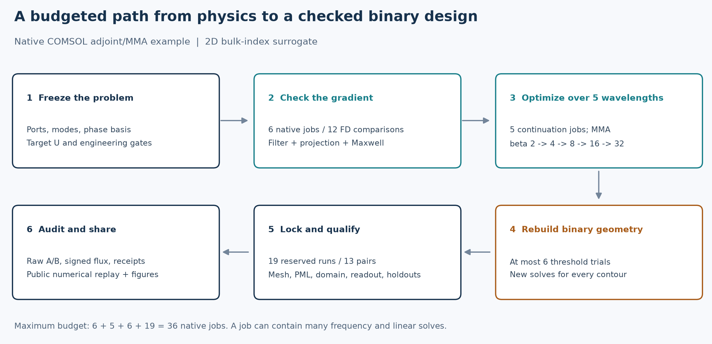
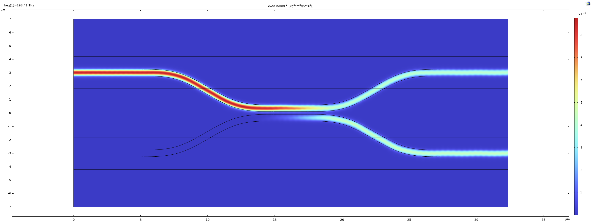
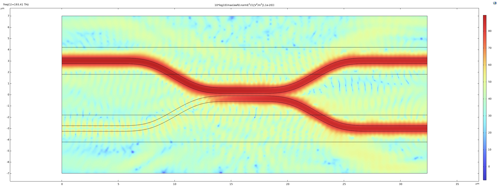

# 光子波导光学 Skill 与工作流

[](https://github.com/Bian-M-X/comsol-photonic-waveguide-optics-skill/actions/workflows/python-compat.yml)
[](https://github.com/Bian-M-X/comsol-photonic-waveguide-optics-skill/actions/workflows/platform-compat.yml)
[](https://github.com/Bian-M-X/comsol-photonic-waveguide-optics-skill/actions/workflows/agent-compat.yml)

- **Python 兼容性**——在 Python 3.11–3.14 上执行代码检查、生成的 Java 片段编译，以及完整的单元/集成测试。
- **平台兼容性**——在 Ubuntu、macOS 和 Windows 上运行同一套测试，并在干净环境中构建、安装打包后的 wheel。
- **智能体兼容性**——验证 Claude Code、Codex 和 ChatGPT 所需的 skill 元数据、agent card 结构及发现目录布局。

**[English](README.md) | [简体中文](README.zh.md)**

## 项目定位

`photonic-workflow` 是可安装的本地运行时与 agent skill，用于支持可审计的
光子集成电路设计闭环。它连接设计意图、器件与紧凑模型契约、复数 S 参数
电路、版图与网表比对、受约束的求解器计划、优化、封装、流片、测量、来源追踪
与证据门。

仓库保留了历史上的 COMSOL 导向名称，但运行时本身与求解器无关。COMSOL、
MATLAB、Lumerical、版图/PDK 工具、仪器和远程服务均通过受约束的适配器接入；本项目
不替代电磁求解器、晶圆厂签核、校准测量或工程判断。

## 图文用例：二维 Hadamard 逆向设计

本案例报告了二维体材料折射率替代模型的离散波长工程验收结果。它不是 220 nm SOI 的有效折射率模型或三维器件，也不是加工结果或实验过程层析。2026-10-10，冻结掩膜的 19 次验证运行和 13 组收敛比较均通过；公开证据包完成了原始矩阵的独立数值复算。该公开复核检查数值自洽性，但没有重新验证原生 COMSOL 收据，也没有重新运行 COMSOL。

| 冻结设计 | 1550 nm 场分布 |
|---|---|
|  |  |

下图仅展示七个实际计算的离散波长点；点间没有连线或插值，不能据此推断连续带宽。五个训练点为 1520、1536.61、1550、1565 和 1580 nm；1543.3 和 1572.3 nm 是未用于掩膜调参的保留点。



| 指标 | 名义中心点 | 19 次验证中的最差值 | 冻结工程门限 |
|---|---:|---:|---:|
| 全逻辑输入最差目标端口吞吐 `eta_all` | 0.9475064821 | **0.9246576286** | ≥ 0.9 |
| 六态最小条件保真度 `F6` | 0.9999822474 | **0.9995299555** | ≥ 0.987 |

这里的 `eta_all` 是任意归一化复逻辑输入中最差的目标输出功率比例；`F6` 是六个指定输入态上的最小条件保真度。它们是本案例预先声明的工程指标，不等同于论文中的实验保真度或实验过程层析，也不构成三维、制造或连续带宽验收。

目标固定为 `U = [[1,i],[i,1]] / sqrt(2)`；预先声明的相位矩阵 `D = diag(1,-i)` 满足 `D U D = H`。没有根据仿真结果拟合端口相位。光谱图统一采用 20/80 nm 核心/包层网格，表中的名义中心点采用 25/100 nm 网格。场图是归一化的传播预览，功率和相位指标由原始数值计算。



流程包括六个方向导数任务、五个分阶段伴随优化任务、最多六次二值阈值试验和十九次冻结验收，合计最多 36 个原生任务。一个任务可能包含多次频率与线性求解。新版默认配置已对照成功设计谱系核对，但没有从零重跑整轮新版一键原生流程。

[项目图文技术报告](docs/research/inverse-design-project-report.zh.md)解释目标、伴随链、失败诊断、二值化、成本和复现方法。

从仓库根目录可复核公开数值包并绘制光谱图：

```console
python docs/showcases/hadamard-2d/verify.py
python docs/showcases/hadamard-2d/plot_spectrum.py
```

复核器会重算原始矩阵、入射归一化、符号通量和 13 组收敛比较。数值自洽性通过不表示原生收据已重新核验，也不表示 COMSOL 已重跑；详细范围、配置和复现步骤见[二维 Hadamard 展示说明](docs/showcases/hadamard-2d/README.md)。

## 0.6.0 更新：降低逆向设计的评估成本

本项目保留一个主 skill，按需读取四条路线：
[预算与参数搜索](references/low-cost-optimization.md)、
[伴随梯度与制造约束](references/adjoint-and-fabrication.md)、
[多保真与误差预算](references/multifidelity-and-error-budgets.md)、
[COMSOL 性能](references/comsol-performance.md)。
[文献证据表](references/inverse-design-evidence.md)区分已实现工具、论文方法和本机实测。

新增 `photonic optimize suggest SPEC --trials TRIAL_DIRECTORY --json`：只读建议下一个
候选，失败尝试计入预算，未完成试验阻止重复派发，搜索保留最终验证预算。
这是轻量、实验性的单保真 GP-EI 工具，不负责原生求解器执行。
运行 `python examples/optimization/analytic_coupler.py --output NEW_DIRECTORY`
可复现等预算软件对比；解析模型参数未经工艺校准。

[原生 Hadamard 示例](examples/comsol-hadamard-inverse/README.md)另提供可执行的
COMSOL 伴随/MMA 路线：密度场滤波、投影与网格延续、多波长复数门目标、二值重建
和冻结掩膜后的验证。它独立计算八个导模输入，检查通量闭合和入射归一化。
0.6.0 的[二维 Hadamard 验收展示](docs/showcases/hadamard-2d/README.md)已于
2026-10-10 完成十九项冻结掩膜检查与十三组收敛比较，并通过独立原始矩阵
复算审计。该结论限于选定二值材料折射率二维替代模型的七个离散波长，
不构成连续带宽、三维堆栈或制造验收。历史失败、选定设计谱系与最终验证成本
分别保留。

十月新增[制造感知鲁棒设计路线](references/fabrication-aware-robust-design.md)和
[全文方法评估](docs/research/literature-methods-2026-10.md)，将 BOSON、PRISM 与可扩展
逆向设计的启发接入现有工作流。[纯 NumPy 示例](examples/optimization/fabrication_robustness.py)
展示轴向采样遗漏交互项、平均晶圆图像稀释坏场景误差（灰度目标还可能正负抵消）的反例。工具不实现完整论文框架，
不证明工艺模型有效性、制造良率或新的原生器件验收。

本项目保留一个主 skill 是因为这些路线共享光学约定、求解器和证据契约；拆成独立安装的
skill 会重复这些规则。只有新成员具有独立调用意图、依赖和行为测试时才进一步拆分。
MCP 现有 13 个工具、36 个资源，公共物理验收契约保持不变。
具体实现、硬件实测与限制见[本轮更新报告](docs/research/workflow-upgrade-2026-09.md)。

## 0.5.0 更新：按任务选择工程验收范围

新版从用户指定的模型、代码或数据出发，按需读取参考资料，让具备较强判断力的
模型选择有助于回答问题的实验，同时保持结论与实际证据相匹配。

| 工作模式 | 示例 | 所需流程 |
|---|---|---|
| `advisory` | 解释 FSR、审阅 Java、诊断场图 | 说明假设，无需验收台账 |
| `exploratory` | 已授权的单点求解、粗参数搜索 | 记录设置、输出与限制；除非项目明确要求，否则无需验收台账 |
| `evidence` | 验收可复用 S 模型、校准测量或布局连接 | 选择对应声明的验收范围，逐项审阅证据 |

这些是 skill 的任务路由模式，不是 CLI 参数。G1 尚未通过不会阻止已获授权的
诊断实验；项目明确规定的“G1 前禁止优化”等要求仍然有效。求解成功是一项观察，
不会自动成为器件资格通过的依据。

**保留的验收要求：**端口、模式及参考面一致性，可复用散射模型的完整复数 S 数据，
逐输入功率核算，与声明相匹配的收敛检查，不可变测量来源，以及 SHA-256 绑定的
证据。无源性、互易性、幺正性、三维比对与工艺角按物理条件和声明适用；数值容差
由决策需求和误差预算确定，不设全器件通用阈值。

**精简的流程：**不再要求所有任务都按 G0–G8 顺序执行，不要求探索实验先建台账，
也不要求普通回答或软件发布提交 G8 工程证据包。新增 `layout-connectivity`
（G0/G5）与 `measurement-capture`（M0/M1），分别支持布局连接和原始测量采集的
独立验收；它们不代表光学/流片或校准测量通过。原有 profile 的含义与持久化 schema
保持兼容；未选择的门显示 `blocked` 不代表整个项目停工，应在契约或交接记录中写明
本次选择的 profile。

**工具与结构：**精简入口，按需加载工程验收及工具选择参考；MCP 新增
`list_recipes`、`inspect_recipe`、`render_recipe`，复用已有六种确定性配方。
0.5.0 当时共 13 个工具、29 个资源；0.6.0 发布时为 35 个资源，本次更新为 36 个。渲染只生成受约束文件，不执行求解器；超出配方覆盖的
建模工作仍可通过已授权的 Java/Python/MATLAB 开发流程完成。

详见[证据门定义](references/verification-gates.md)、[工具选择](references/tool-selection.md)
和[工程验收门评估](docs/research/engineering-gates-0.5-review.md)。

## 效果展示：从提示词到 COMSOL SOI 欧拉弯 50:50 分束器

这个经过公开发布清理的测试案例展示了：本套件如何把自然语言需求转化为可审计的 COMSOL 模型、耦合长度筛选、细网格结果和场图检查。器件是在 1550 nm 工作的 SOI 四端口倏逝场定向耦合器。八段实体欧拉插值曲线将 500 nm 宽波导引入和引出 200 nm 耦合间隙；每段欧拉弯转角为 30 度，最小曲率半径为 5.0 um。

| 测试项目 | 取值 |
|---|---|
| 测试模型 | `GPT-5.6sol high` |
| Skill | `$photonic-waveguide-optics` |
| 求解器 | COMSOL Multiphysics 6.4.0.293，电磁波-频域 |
| 平台 | 220 nm SOI 背景；二维有效折射率模型（EIM） |
| 波长 | 1550 nm |
| 选定耦合结构 | 边缘间隙 0.20 um；平行耦合长度 2.50 um |
| 证据等级 | 单波长、细网格二维 EIM 初步结果 |

以下原样保留本次测试提示词。其中本地 skill 路径是提示词的一部分，读者使用时应替换成自己的安装路径。

```text
[$photonic-waveguide-optics](C:\\Users\\lenovo\\.codex\\skills\\photonic-waveguide-optics\\SKILL.md) 请使用此skill套件利用comsol给我一份SOI基础的回转半径5um的欧拉弯在1550nm波长下形成的50:50分束器的仿真，建议使用倏逝场耦合方案，最终给出场图
```

### 场分布结果

| 线性场图：`ewfd.normE^2` | 对数场图：归一化 `10 log10` 标度 |
|---|---|
|  |  |

线性场图显示上方输入端口的能量耦合到两个导波输出；对数场图用于暴露弱背景辐射，并与显式积分得到的开放边界通量相互核对。场图本身不会被当作器件资格通过的充分证据。

### 最终细网格结果

| 指标 | 结果 |
|---|---:|
| P3 透射率 `T31` | 0.485296 |
| P4 透射率 `T41` | 0.513588 |
| 已收集输出功率分配 | 48.5839% / 51.4161% |
| 已收集总功率 `T31 + T41` | 0.998884 |
| 已收集功率对应的额外损耗 | 0.00485 dB |
| 输入反射 `R11` | 5.15e-6（约 -52.88 dB） |
| 开放边界向外通量 | 0.001112 W/m（约为每米输入功率的 0.111%） |
| 端口模式有效折射率 | 2.22879723 |
| 网格 / 频域自由度 | 558,912 个三角形 / 3,913,885 DOF |

2.50 um 方案满足本测试定义的 50:50 ±2 个百分点验收目标。粗网格到细网格的已收集上端口比例仅变化 0.00327 个百分点。

### 1550 nm 下的耦合长度筛选

| 耦合长度（um） | `T31` | `T41` | 已收集上端口比例 | `T31 + T41` |
|---:|---:|---:|---:|---:|
| 1.0 | 0.673455 | 0.325021 | 0.674483 | 0.998476 |
| 2.5，粗网格 | 0.485277 | 0.513634 | 0.485806 | 0.998911 |
| 4.0 | 0.299400 | 0.699629 | 0.299691 | 0.999029 |
| 10.0 | 0.035454 | 0.963388 | 0.035495 | 0.998842 |

能量从 P3 向 P4 单调转移，符合倏逝场定向耦合的物理预期。工作流先冻结器件契约和验收规则，再验证直波导/数值端口基线，检查端口与开放边界选择是否互斥且完备，筛选耦合长度，对选定结构执行细网格复算，最后审计两种场图与功率账本。

> **结论边界：**这是单输入、单波长、初步的二维 EIM 工程结果。完整器件资格仍为 `blocked`；尚需同一模型四个独立输入的复数 S 矩阵波长扫描、带宽和边界/PML 敏感性。若要进一步声明工艺鲁棒性或真实三维堆栈性能，还需对应工艺角和三维验证。
>
> 当前提交中的图片和摘要是经公开清理的展示材料，不是可复现的 G8 证据包；
> 不能据此推断本地 Java 源码、求解日志或原始表格已经公开。

> Skill token：`$photonic-waveguide-optics`
>
> Python 包与 CLI：`photonic-workflow` / `photonic`
>
> 当前包版本：`0.6.0`（alpha）
>
> 仓库：`Bian-M-X/comsol-photonic-waveguide-optics-skill`

## 0.6.0 版本提供的能力

| 能力面 | 当前职责 |
|---|---|
| 可安装核心 | Click CLI、Pydantic 契约、NumPy 电路组合、项目配置、运行记录、来源追踪、产物审计，以及 G0-G8/M0-M4 台账 |
| PIC 与 PDK 契约 | 设计意图、器件、端口、组件、网表、版图、PDK/工艺/工艺角模型、model card、封装、测试、流片和测量记录 |
| 电路兼容性 | 验证和组合旧版 `assembly.json` 1.0 与长表复数 S 参数 CSV |
| 可复用建模配方 | 从已审查 LT-aMZI 工作流提炼并版本化的圆弯/欧拉弯几何、分段端口窗口、体材料色散和共同模态基准下的双端口诊断；默认采用 fail-closed（证据不足时不通过）策略 |
| 外部后端 | 能力探测与受限计划；商业软件的实际执行仍需单独授权并通过测试门 |
| MATLAB | Phase A 检查、清单、计划、受控封装（wrapper）、结果与 Engine 探测界面；真实本地冒烟测试属于 Phase B |
| MCP | 低依赖 stdio JSON-RPC 传输；manifest（清单）列出全部已注册 skill 资源，有 13 个职责明确的工具；不执行求解器、MATLAB、仪器或任意 shell |
| 旧入口 | 在包服务等价性回归测试期间，保留现有 Python 与 PowerShell 命令作为兼容入口 |
| 研究记录 | 官方/项目维护的 PIC 与 MATLAB 工具调研，明确区分本地可用性与物理验证边界 |

实现状态和本地可用性分开报告：

- 实现状态：`implemented`、`experimental`、`planned` 或 `unverified`；
- 可用状态：`available`、`unavailable`、`incompatible` 或 `unverified`。

这两个字段都不是器件证据门。只有经过检查的证据才能改变 G 或 M 门状态。

## 安装

需要 Python 3.11 或更高版本。请从经过审查的代码检出目录中安装与求解器无关的核心：

```powershell
git clone https://github.com/Bian-M-X/comsol-photonic-waveguide-optics-skill.git
Set-Location .\comsol-photonic-waveguide-optics-skill

python -m pip install -e .
photonic --version
```

核心只安装 Click、Pydantic 和 NumPy。可选依赖组仅声明集成类别，不会下载商业产品、许可证、PDK、MATLAB 工具箱或仪器软件：

```powershell
python -m pip install -e ".[layout,circuit,sparams]"
python -m pip install -e ".[dev]"
```

仅在获批的本地工作流中安装可选依赖，并独立审查其许可证。`all` extra 仅包含 `pyproject.toml` 列出的可再分发 Python 包，并不代表完整的 PIC 环境。

若要安装 Codex skill，请把本仓库放入可被发现的 skills 目录，例如：

```powershell
$SkillRoot = Join-Path $env:USERPROFILE '.codex\skills\photonic-waveguide-optics'
git clone https://github.com/Bian-M-X/comsol-photonic-waveguide-optics-skill.git $SkillRoot
```

更改 skill 发现位置后，请重启 Codex 或新建任务。

## 五分钟无求解器入门

创建 MZI 项目、执行验证并查看 fail-closed 状态：

```powershell
$ProjectRoot = Join-Path $env:TEMP 'photonic-mzi-demo'

photonic init $ProjectRoot --device-family mzi --json
photonic check --project-root $ProjectRoot --json
photonic circuit validate "$ProjectRoot\circuits\assembly.json" --json
photonic circuit compose "$ProjectRoot\circuits\assembly.json" `
  --output "$ProjectRoot\data\processed\circuit_sparameters.csv" `
  --summary "$ProjectRoot\verification\circuit_summary.json" `
  --json
photonic status --project-root $ProjectRoot --json
```

随附测试样例是确定性的解析示例，用于测试契约校验和网络组合；它们不是合格 PDK、已制造器件或全波验证。

可用初始化配置包括：

- `pdk-first`；
- `layout-first`；
- `custom-device-first`；
- `matlab-legacy-layout`；
- `matlab-assisted-design`。

`photonic.toml` 记录运行策略和别名。物理几何、材料、模式、拓扑、边界条件、目标与验收阈值应位于版本化的设计和运行契约中。

## CLI 地图

运行 `photonic <group> --help` 查看完整命令列表。

| 范畴 | 命令组 |
|---|---|
| 项目与恢复 | `init`、`check`、`doctor`、`status`、`inspect`、`report` |
| PDK 与器件数据 | `pdk`、`component`、`model`、`sparams`、`variation` |
| 可复用建模 | `recipe list`、`recipe inspect`、`recipe render` |
| 电路与版图 | `circuit`、`netlist`、`layout` |
| 外部计划 | `solver`、`matlab` |
| 任务与发布 | `optimize`、`package`、`testplan`、`tapeout`、`measurement` |
| 证据与安全 | `gate`、`audit` |

后端是否就绪与器件证据刻意分离。每次只初始化、检查和评估一份后端记录：

```powershell
photonic gate adoption list --project-root . --json
photonic gate adoption init matlab-runtime --project-root . --dry-run --json
photonic gate adoption init matlab-runtime --project-root . --json
photonic gate adoption inspect matlab-runtime --project-root . --json
photonic gate adoption record matlab-runtime capability-probe blocked `
  --reason "normal interactive-user probe is pending" `
  --project-root . --json
photonic gate adoption evaluate matlab-runtime --project-root . --json
```

记录存放在 `verification/adoption/`。初始化不会覆盖已有记录，`--dry-run` 不写文件。提供给 CLI 的通过/失败证据必须是可读取的项目相对路径文件；只填写一个非空引用不被接受为证明。

JSON 响应采用统一结构，包含命令、状态、退出码、数据、警告和错误。重要退出码如下：

| 代码 | 含义 |
|---:|---|
| 0 | 成功 |
| 1 | 内部或未分类失败 |
| 2 | 输入无效 |
| 3 | 能力不可用 |
| 4 | 版本不兼容 |
| 5 | 执行失败 |
| 6 | 验收拒绝 |
| 7 | 安全违规 |
| 8 | 超时 |

只读状态命令可能返回 0，同时所有证据门仍为 `blocked`。执行成功和物理验收是两个独立状态。

### 可复用建模配方

内置 recipe registry 把审查过的 LT-aMZI 建模原语转换为稳定、可检查的调用，无需复制项目专用模型，也不声称求解器验收通过：

```powershell
photonic recipe list --json
photonic recipe inspect geometry.symmetric-euler-bend --json
photonic recipe render geometry.symmetric-euler-bend `
  --input .\examples\recipes\symmetric-euler-bend.json `
  --renderer canonical-json `
  --json
```

每个 recipe 都使用精确语义版本、显式单位、严格输入验证、确定性输出和随附来源信息。只有白名单内的几何/端口 recipe 能生成受限 COMSOL Java 片段；渲染不是求解器执行，也不是物理证据。每个 Java 片段还要求显式且安全的 `--instance-id`，从而让多个 MZI 臂或路由并存且不发生 feature tag 冲突。详见 `references/modeling-recipes.md`。

## 建模与证据工作流

使用能够回答既定问题的最低成本模型：

```text
设计意图与声明
  -> 直波导与端口基线
  -> 独立验证的组件模型
  -> 完整复数多端口 S 数据
  -> 已验证电路与敏感性
  -> 端口感知版图和提取连通性
  -> 选定并纳入后续验收的全波检查
  -> 鲁棒性与证据包
  -> 测试准备、测量、相关与再校准
```

G0-G8 跟踪从设计到证据打包的过程，M0-M4 是独立的制造后流程：

| 证据门 | 必需证据 |
|---|---|
| `G0` | 器件契约和拟声明内容 |
| `G1` | 端口与直波导基线 |
| `G2` | 组件资格验证 |
| `G3` | 组装契约 |
| `G4` | 电路行为 |
| `G5` | 版图与连通性 |
| `G6` | 纳入后续验收的全波子组件 |
| `G7` | 鲁棒性与优化 |
| `G8` | 可复现证据包 |
| `M0` | 测试准备 |
| `M1` | 原始数据完整性 |
| `M2` | 校准测量 |
| `M3` | 仿真/测量相关 |
| `M4` | 紧凑模型再校准 |

缺少证据时状态是 `blocked`，不是通过。证据门通过需要明确证据。

## 阶段边界

阶段标签描述集成成熟度，不代表器件验收：

- **Phase A——可靠本地核心：**可安装包、契约、安全计划、mock fixture、运行恢复、证据门、旧接口等价性、MATLAB 检查/计划界面、薄 MCP 和适合公开 CI 的测试。
- **Phase B——已授权本地验证：**使用有许可证的 `matlab -batch` 和 `matlab.unittest` 冒烟测试、可选 Engine 检查、数据往返、旧版版图/FDFD/RF fixture 与本地数值等价性。
- **Phase C——受限外部集成：**COMSOL LiveLink、Lumerical、仪器、Simulink、商业 PDK/流片、封装/测试执行、测量相关，以及通过后端专用接入验收门（adoption gate） 后的大规模或远程优化。

文件、描述符、schema、产品列表、import 和 dry-run 计划不能证明 Phase B/C 已执行。MATLAB FDFD 结果不是三维全波证据；生成 GDS 不是晶圆厂 DRC 签核；求解器收敛也不是测量相关。

## MATLAB

MATLAB 是可选项。默认受控路径为 `matlab -batch`；MATLAB Engine 只是可选探测和低延迟路径，不是工作流权威。

```powershell
photonic matlab check --json
photonic matlab doctor --json
photonic matlab products --json
photonic matlab toolboxes --json
photonic matlab sessions --json
photonic matlab plan .\runs\example\run_spec.json --project-root . --json
```

Phase A 计划只接受已注册入口 ID，并围绕仓库自带的固定 MATLAB 函数组装参数数组，不接受任意 MATLAB 代码。找不到可执行文件时必须结构化报告 `unavailable`；Engine 包可导入不证明存在兼容、已授权且可信的会话。

在 Phase A 运行时，未带 `--execute` 的 `matlab run` 也是计划界面；真实执行和 `matlab test` 保持为 fail-closed 的 Phase B hook。后续版本若启用明确授权的本地 Phase B 验证，应记录 MATLAB release、产品与工具箱清单、封装脚本（wrapper）与输入哈希、结果 manifest、预期产物、容差和声明边界。LiveLink、Lumerical、仪器、Simulink 和真实流片工作流在各自后端接入验收门 通过前都属于 Phase C。

参见 `docs/architecture/matlab-integration.md`、`docs/architecture/matlab-security.md` 和 `docs/research/matlab-tool-landscape.md`。

## COMSOL 与其他求解器

请自行提供兼容且已授权的安装。可信的旧版 COMSOL 执行路径仍是受限 Java API 加批处理 runner：

```powershell
$env:PHOTONIC_SOLVER_ROOT = 'C:\Path\To\LicensedSolverRoot'

.\scripts\invoke-waveguide-java-batch.ps1 `
  -SolverRoot $env:PHOTONIC_SOLVER_ROOT `
  -JavaFile 'C:\Path\To\ModelSource.java' `
  -OutputFile 'C:\Path\To\OutputModel.mph' `
  -BatchLog 'C:\Path\To\BatchLog.log' `
  -DryRun
```

移除 `-DryRun` 前，应审查路径、选择集、study 顺序、成本、并发、预期输出和声明等级。渲染后的求解器计划只支持来源追踪，不等于求解器执行或物理证据。

`docs/research/tool-landscape.md` 和 `docs/research/matlab-tool-landscape.md` 中的官方来源工具调研，明确区分文档宣称能力、本地可用性与已经验证的物理结果。

## MCP 接口

`scripts/mcp_photonic_server.py` 是包传输层的兼容启动器。当前版本提供以下接口：

- 由单一权威 registry 声明的资源：一个 server manifest、所有已注册参考文档，以及所有受限 agent role contract；
- 13 个工具：新增 `list_recipes`、`inspect_recipe`、`render_recipe`，以及原有 `list_allowed_roots`、`create_project_scaffold`、`audit_project_artifacts`、`parse_sweep_table`、`validate_contract`、`inspect_project`、`validate_circuit`、`compose_circuit`、`gate_status` 和为兼容保留名称的 `run_java_batch`。

入口按用户指定的模型、代码或数据选择参考资料；完整资格验证流程按需读取。
新增配方工具复用已有数值实现，返回紧凑目录或带 SHA-256 的文件回执，
不把生成配置视为物理验证。工具选择与官方资料调研见
`references/tool-selection.md`，重构审阅说明见
`docs/research/skill-refactor-review.md`。已运行的旧 MCP 进程仍需重启才能重新发现工具。

`run_java_batch` 只渲染脱敏的 dry-run 计划。MCP 不暴露任意 shell/Python/MATLAB 执行，也不实际执行求解器或仪器。读根目录与写根目录分开；未配置可写根目录时写操作失败。已安装 wheel 包含所有 MCP 参考资料和 agent 资源的只读镜像，因此 `photonic-mcp` 不依赖当前工作目录或源码 checkout。`PHOTONIC_SKILL_ROOT` 仍可作为指向经审查 skill 树的显式指定的覆盖路径。

后端接入边界参见 `references/comsol-mcp-evaluation.md`。

## 旧接口兼容

在业务逻辑迁移到包内期间，下列现有接口继续受支持：

- `scripts/photonic_assembly.py validate|compose`；
- `scripts/parse-comsol-sweep.py`；
- `scripts/new-photonic-project.ps1`；
- `scripts/audit-simulation-artifacts.ps1`；
- `scripts/invoke-waveguide-java-batch.ps1`；
- `scripts/mcp_photonic_server.py`。

v1 assembly schema、端口顺序、模型等级词汇、精确波长网格、长表复数 CSV 列与六列组合输出仍是兼容契约。更改既有项目前请阅读 `docs/migration.md`。

## 验证 checkout

公开核心的验证刻意不依赖 MATLAB、COMSOL、Lumerical、商业 PDK、仪器、网络 API 或云账号：

```powershell
python -m pip install -e '.[dev]'

python -B -m unittest discover -s tests -p 'test_*.py'
python -B .\scripts\update_contract_surface_snapshot.py
python -B .\scripts\test_photonic_assembly.py
python -B .\scripts\test_numeric_tools.py
python -B .\scripts\test_mcp_photonic_server.py
python -B .\scripts\test_skill_metadata.py
.\scripts\test_powershell_safety.ps1
.\scripts\sync-packaged-skill-resources.ps1
.\scripts\sync-packaged-matlab-resources.ps1
ruff check src tests scripts

photonic --version
photonic audit artifacts . --fail-on-issues --json
git diff --check
```

提交新包接口前，先暂存预期文件并运行 `git diff --cached --check`；提交后运行 `git show --check --oneline HEAD`。普通 `git diff --check` 不检查未跟踪文件。

CI 还会执行 Ruff 与 skill 元数据 schema 检查，在 Python 3.11-3.14 的 Windows 环境运行完整测试，在 Ubuntu 和 macOS 上运行 portable-core 测试，构建 sdist 和 wheel，在 checkout 之外的干净环境安装 wheel，读取全部 MCP 资源，验证打包模板并运行 `pip check`。版本标签会触发全新发布构建、SHA-256 清单与 GitHub 构建来源证明。发布顺序参见 `docs/maintenance.md`。

当所选环境中存在 Codex `skill-creator` 验证脚本和 PyYAML 时，还可运行：

```powershell
python "$env:USERPROFILE\.codex\skills\.system\skill-creator\scripts\quick_validate.py" .
```

不要为了可选验证器而安装或改变全局 Python 环境。

## 文档地图

`SKILL.md` 是简洁的操作路由器，详细资料位于 `references/` 与 `docs/`：

| 需求 | 阅读内容 |
|---|---|
| 运行时架构与阶段 | `docs/architecture/runtime-design.md`、`docs/roadmap.md` |
| 契约与适配器 | `docs/architecture/adapter-contract.md`、`docs/architecture/design-intent.md` |
| 第三方适配器开发 | `docs/providers/authoring-third-party-adapter.md` |
| PDK 与紧凑模型 | `docs/architecture/pdk-model.md`、`docs/architecture/compact-model-lifecycle.md` |
| MATLAB 集成与安全 | `docs/architecture/matlab-integration.md`、`docs/architecture/matlab-security.md` |
| 来源追踪与迁移 | `docs/architecture/provenance.md`、`docs/migration.md` |
| 维护与兼容性 | `docs/maintenance.md` |
| 发布历史 | `CHANGELOG.md` |
| PIC 与 MATLAB 工具研究 | `docs/research/tool-landscape.md`、`docs/research/matlab-tool-landscape.md` |
| 工作流配置 | `docs/workflows/` |
| COMSOL 环境与物理 | `references/environment-and-runner.md`、`references/wave-optics-port-models.md` |
| 源扫描与复数 S 矩阵 | `references/frequency-domain-source-sweeps.md` |
| 器件与干涉仪工作流 | `references/device-family-workflows.md`、`references/interferometer-workflows.md` |
| 可复用建模配方与来源 | `references/modeling-recipes.md` |
| 分层组合 | `references/hierarchical-device-workflow.md` |
| 证据门与报告 | `references/verification-gates.md`、`references/optimization-and-reporting.md` |
| MCP 评估 | `references/comsol-mcp-evaluation.md` |
| 来源、许可证与发布 | `references/source-notes.md`、`references/legal-and-trademark-notes.md` |

## 安全、许可证与声明

本仓库是独立工作流辅助工具，与 COMSOL AB、MathWorks、Ansys、晶圆厂或其他工具供应商不存在隶属、背书、赞助或授权关系。仓库不包含商业求解器、MATLAB 产品、PDK、许可证文件、专有模型或供应商数据集。产品与公司名称仅用于标识可选的第三方环境。

发布前应删除本地路径和用户名、凭据、许可证数据、仪器地址、NDA 材料、专有论文/模型、`.mph`、编译产物、原始日志、缓存和未发布结果。请审计完整产物树并逐项检查第三方许可证。开源软件不会授予商业产品或晶圆厂 PDK 的访问权限。

仓库原创文字和辅助代码按 [MIT License](LICENSE) 提供。第三方工具、API、商标、文档、模型、数据集与生成产物仍受各自权利人的条款约束。
